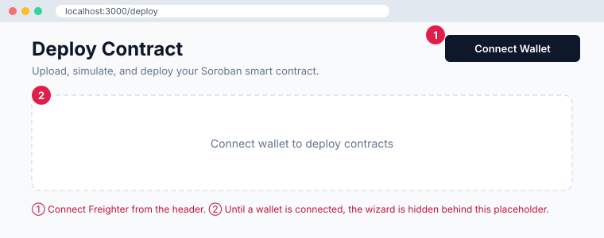
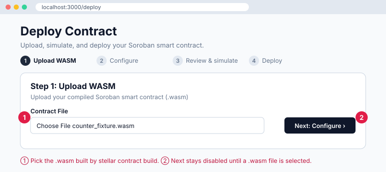
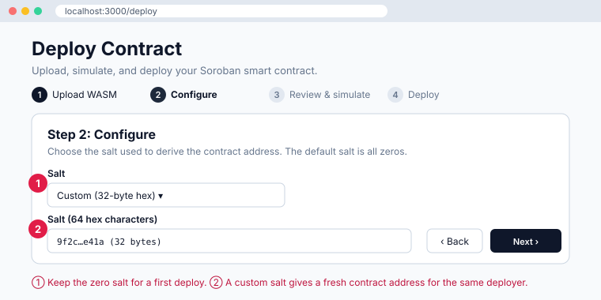
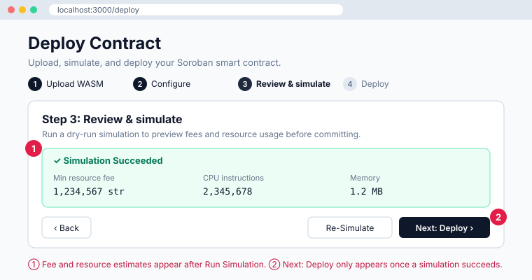
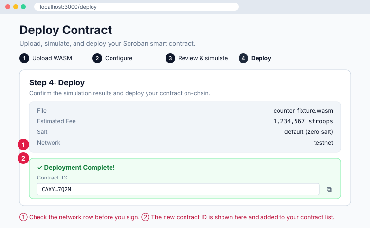

# Tutorial: Deploy Your First Soroban Contract

This walkthrough takes you from a compiled `.wasm` file to a live contract ID
using the DevConsole deploy wizard at `/deploy`. It covers two targets:

- **Testnet**, the public Stellar test network. Start here if you are new.
- **Local sandbox**, a standalone network running in Docker on your machine.

The wizard has four steps: **Upload WASM → Configure → Review & simulate →
Deploy**. Each step below has an annotated illustration of the screen.
Numbered red markers in each illustration match the numbered notes under it.

> The illustrations are drawn from the wizard's source
> ([`apps/web/app/deploy/page.tsx`](../apps/web/app/deploy/page.tsx)), so the
> labels and layout match the real UI. Fee and resource values in them are
> examples only.

## Contents

1. [Before you start](#before-you-start)
2. [Choose a target network](#choose-a-target-network)
3. [Step 0: Connect your wallet](#step-0-connect-your-wallet)
4. [Step 1: Upload WASM](#step-1-upload-wasm)
5. [Step 2: Configure](#step-2-configure)
6. [Step 3: Review & simulate](#step-3-review--simulate)
7. [Step 4: Deploy](#step-4-deploy)
8. [After deployment](#after-deployment)
9. [Error reference](#error-reference)

## Before you start

You need:

- The DevConsole running locally. See the [quickstart](./quickstart.md).
- The [Freighter](https://www.freighter.app/) browser extension. The wizard
  signs both deployment transactions through Freighter.
- A compiled contract. To build one of the fixtures in this repo:

  ```bash
  cd contracts/counter-fixture
  stellar contract build
  ```

  The `.wasm` file is written under `contracts/target/`, in
  `wasm32v1-none/release/` on current Stellar CLI versions or
  `wasm32-unknown-unknown/release/` on older ones.

## Choose a target network

The wizard deploys to whichever network is active in the network switcher in
the header. **The network selected in Freighter must match it.** If the two
differ, the console shows a network-mismatch banner. Fix the mismatch before
you sign anything.

### Testnet

1. In the DevConsole network switcher, select **Testnet**.
2. In Freighter, switch to **Testnet**.
3. Fund your account. Use the Friendbot button on the wallet page, or run:

   ```bash
   curl "https://friendbot.stellar.org?addr=YOUR_PUBLIC_KEY"
   ```

### Local sandbox

1. Start a standalone network with Soroban RPC enabled:

   ```bash
   docker run --rm -it -p 8000:8000 --name stellar \
     stellar/quickstart:latest --local --enable-soroban-rpc
   ```

   Wait until the container logs show the RPC server is ready. This can take
   a minute on first start.

2. In the DevConsole network switcher, select **Local Standalone**. Its
   defaults are:

   | Setting    | Value                                |
   | ---------- | ------------------------------------ |
   | RPC URL    | `http://localhost:8000/soroban/rpc`  |
   | Horizon    | `http://localhost:8000`              |
   | Passphrase | `Standalone Network ; February 2017` |

3. In Freighter, add a custom network with the same RPC URL, Horizon URL and
   passphrase, then switch to it.
4. Fund your account from the sandbox's own Friendbot. The public Friendbot
   cannot fund local accounts.

   ```bash
   curl "http://localhost:8000/friendbot?addr=YOUR_PUBLIC_KEY"
   ```

> **Port 8000 is shared.** The quickstart container needs port 8000. If
> another process holds it, the container fails to start. See
> [Port already in use](./troubleshooting.md#network) in the troubleshooting
> guide.

## Step 0: Connect your wallet

Open [http://localhost:3000/deploy](http://localhost:3000/deploy).



1. Click **Connect Wallet** in the header and approve the request in Freighter.
2. Until a wallet is connected, the page shows only the placeholder _Connect
   wallet to deploy contracts_.

> **Common errors**
>
> - _"Wallet session expired. Please reconnect."_: Freighter locked or the
>   session timed out. Unlock Freighter and connect again.
> - _"Network mismatch — verify before signing"_: Freighter and the
>   DevConsole are on different networks. Switch one so they match.

## Step 1: Upload WASM



1. Under **Contract File**, choose the `.wasm` file you built.
2. Click **Next: Configure**. The button stays disabled until a file is
   selected.

> **Common errors**
>
> - _"Please upload a .wasm file"_: the file name does not end in `.wasm`.
>   Select the build output itself, not the crate folder or a `.rs` file.
> - **You were sent back to this step.** The wizard remembers which step you
>   reached, but browsers cannot restore a selected file. If you leave the page
>   and come back, the wizard returns to Step 1. Select the file again.

## Step 2: Configure



The salt is combined with your deployer address to derive the contract
address. The same deployer and salt always give the same address.

1. For a first deploy, leave **Salt** on **Default (zero salt)**.
2. To deploy another instance of a contract from the same account, choose
   **Custom (32-byte hex)** and enter 64 hex characters. To generate one:

   ```bash
   openssl rand -hex 32
   ```

> **Common errors**
>
> - _"Salt is required and cannot be empty."_: custom mode is selected with
>   an empty field. Enter a salt or switch back to the default.
> - _"Salt must be exactly 64 hex characters (32 bytes). Current length: N."_:
>   remove any `0x` prefix, spaces or line breaks.
> - _"Salt contains invalid characters…"_: only `0-9`, `a-f` and `A-F` are
>   allowed.

## Step 3: Review & simulate



Click **Run Simulation**. The console builds the WASM upload transaction and
dry-runs it against the active network's RPC. Nothing is submitted and
nothing is signed at this point.

1. On success, the panel shows the minimum resource fee, CPU instructions and
   memory the upload will use.
2. **Next: Deploy** appears only after a successful simulation. If you change
   the file, the simulation result is cleared and you must run it again.

> **Common errors**
>
> - _"Simulation failed: Account not found"_: the connected account does not
>   exist on this network yet. Fund it with Friendbot (see
>   [Choose a target network](#choose-a-target-network)) and simulate again.
> - _"Simulation failed: Failed to fetch"_ or a network error: the RPC URL is
>   unreachable. On testnet, check your connection. On the local sandbox,
>   confirm the container is running and port 8000 is reachable.
> - **Simulation fails with a resource or size error**: the WASM is too large
>   or uses too much CPU or memory. Build in release mode, and optimize the
>   output with `stellar contract optimize --wasm <file>` if your CLI version
>   supports it.

## Step 4: Deploy



Review the summary, then click **Deploy Contract**. Deployment sends **two
transactions**, and Freighter asks you to sign each one:

1. **Upload WASM**: installs the contract code on the network.
2. **Instantiate**: creates a contract instance from that code using your
   salt.

The status line shows progress: _Uploading WASM to network…_ → _Submitting
WASM…_ → _Waiting for WASM confirmation…_ → _Instantiating contract…_ →
_Finalizing deployment…_

1. Check the **Network** row before you sign the first prompt.
2. When the instance is confirmed, **Deployment Complete!** appears with the
   new contract ID. Use the copy button next to it. The contract is also added
   to your contract list automatically.

> **Common errors**
>
> - _"Deployment failed: User declined access"_ (wording varies by Freighter
>   version): you rejected a signing prompt. Click **Deploy Contract** again.
>   If you rejected the second prompt, the WASM is already installed. Uploading
>   it again is harmless but costs another fee.
> - _"Deployment failed: WASM upload failed: ERROR"_ or _"TRY_AGAIN_LATER"_:
>   the RPC rejected the upload transaction. `TRY_AGAIN_LATER` means the node
>   is busy, so wait a few seconds and retry. `ERROR` usually means
>   insufficient balance. Fund the account and retry.
> - _"Deployment failed: Instantiation failed"_: the most common cause is that
>   a contract already exists at the derived address. This happens when you
>   redeploy from the same account with the same salt. Go back to Step 2 and
>   use a new custom salt.
> - **The status line clears without a success message.** The wizard polls
>   for confirmation for about 20 seconds. On a slow network, the transaction
>   can confirm after polling stops. Look up your account on
>   [Stellar Expert](https://stellar.expert/explorer/testnet) (testnet) to see
>   whether the instance was created before you retry.

## After deployment

- Open **Contracts** and select the new contract ID to inspect it and invoke
  its methods.
- To deploy the same code again, return to Step 2 and pick a new custom salt.
- On the local sandbox, all state is lost when the quickstart container stops.
  Deploy again after each restart.

## Error reference

| Where  | Message                                | Fix                                                 |
| ------ | -------------------------------------- | --------------------------------------------------- |
| Step 0 | Wallet session expired                 | Unlock Freighter and reconnect                      |
| Step 0 | Network mismatch                       | Select the same network in Freighter and the header |
| Step 1 | Please upload a .wasm file             | Select the compiled `.wasm` output                  |
| Step 2 | Salt must be exactly 64 hex characters | Remove `0x`, spaces and line breaks                 |
| Step 3 | Account not found                      | Fund the account with Friendbot                     |
| Step 3 | Failed to fetch                        | Check the RPC URL and that the sandbox is running   |
| Step 4 | User declined access                   | Retry and approve both prompts                      |
| Step 4 | WASM upload failed: TRY_AGAIN_LATER    | Wait and retry                                      |
| Step 4 | Instantiation failed                   | Use a new custom salt                               |

For environment problems outside the wizard (ports, Node versions, Prisma),
see the [troubleshooting guide](./troubleshooting.md).
